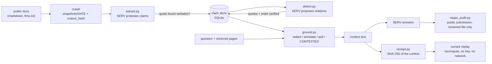

<div align="center">

# Currant

[](https://github.com/Dami904/currant/actions/workflows/ci.yml)
[](https://github.com/Dami904/currant/actions/workflows/ci.yml)
[](LICENSE)
[](pyproject.toml)
[](https://www.openserv.ai)
<!-- ADD WHEN IT EXISTS: uncomment, replace <...>, and check each badge opens the real page.
[](https://<your-host>.vercel.app)
[](<video-url>)
-->

### Can your agent prove the docs it answered from were the current ones?

Currant is a stale-truth firewall for agents that read documentation that keeps changing. Before
the model answers, it finds which claim was superseded (from the text alone, with no labels), cuts
that sentence, puts the winning evidence in front of the model, and returns a receipt that anyone
can replay. Nothing is cut, annotated or pulled unless our own code found a supporting quote, word
for word, in the stored page: the model proposes, our code checks. Built from scratch for the
OpenServ + Reppo hackathon.

**[ Watch the demo ](#watch-the-demo)** · **[ Judge it in 90 seconds ](#judge-it-in-90-seconds)** · **[ The core proof ](#the-core-proof)** · **[ Real conflicts found ](#what-it-found-on-real-documentation)** · **[ Where it lost ](#honesty-limitations)**

</div>

---

## Watch the demo

The demo video has not been recorded yet. Until it is, the closest thing is
[the core proof below](#the-core-proof), which is the same run in text.

<!-- ADD WHEN THE VIDEO EXISTS: delete the paragraph above, uncomment this block, and replace <...>.
     For YouTube the thumbnail is https://img.youtube.com/vi/<id>/maxresdefault.jpg

<div align="center">

<a href="<video-url>">
  " alt="Currant demo" width="760" />
</a>

**[ Watch: <one-line description> (<m:ss>) ](<video-url>)**

</div>

| | |
|---|---|
| [0:00](<video-url>?t=0) | **The problem:** two pages, two numbers, nothing says which is current |
| [<m:ss>](<video-url>?t=<seconds>) | **A receipt anyone can replay:** `currant replay` prints REPLAY OK |
| [<m:ss>](<video-url>?t=<seconds>) | **What Currant changed:** the cut sentence, the pulled evidence, the CONTESTED notice |
| [<m:ss>](<video-url>?t=<seconds>) | **Where it lost:** the Reppo audit and the -7.7 |

State here that the footage is real and not mocked, and name the numbers to watch for.
-->

---

## Judge it in 90 seconds

<!-- ADD WHEN DEPLOYED: replace the Live line below with
**Live: [<your-host>.vercel.app](https://<your-host>.vercel.app)**: the landing page and the in-browser receipt replay, deployed from `site/`. The command-line path below is the full thing.
-->
**Live:** not deployed yet. The landing page and an in-browser receipt replay are in
[`site/`](site/) and run locally with `cd site && pnpm install && pnpm dev`. The command-line path
below needs no key and no network.

| | |
|---|---|
| **1054** | tests, all offline; a `conftest.py` makes any socket call fail |
| **0.857 / 0.828** | held-out precision and recall on 93 synthetic test items, scored once after a public freeze (dev was 1.000 / 0.892: a miss) |
| **3** | real conflicts found in Reppo's own docs, reported upstream ([issue #11](https://github.com/Reppo-Labs/docs/issues/11), [PR #12](https://github.com/Reppo-Labs/docs/pull/12)) |
| **-7.7** | Currant against baseline on those 3 questions in Reppo's own judges' scores (59.0 against 66.7): **we lost**, and why is below |

```bash
uv sync
uv run currant replay examples/demo/receipt.json --db examples/demo/store.db
uv run python scripts/build_drift_page.py --check    # every quote below is verbatim in the snapshots
```

If `uv` is not on your PATH, use `python -m uv` instead.

---

## Table of contents

- [Watch the demo](#watch-the-demo)
- [Judge it in 90 seconds](#judge-it-in-90-seconds)
- [The core proof](#the-core-proof)
- [What it found on real documentation](#what-it-found-on-real-documentation)
- [The problem](#the-problem)
- [What was built](#what-was-built)
- [Architecture](#architecture)
- [How it decides](#how-it-decides)
- [The test contract](#the-test-contract)
- [Engineering decisions](#engineering-decisions)
- [Integrity: what is real, what is staged](#integrity-what-is-real-what-is-staged)
- [The landing page](#the-landing-page)
- [Honesty: limitations](#honesty-limitations)
- [Tech stack](#tech-stack)
- [Project layout](#project-layout)
- [Run it locally](#run-it-locally)
- [Tests](#tests)
- [Attribution](#attribution)
- [License](#license)

---

## The core proof

> "What are the API rate limit and the maximum upload size?"

The committed demo (`examples/demo/`) is built from invented pages on `docs.example.com`. Two of
them disagree about the upload size, and one older page gives a rate limit that a changelog says
was replaced. This is the context Currant hands the model, and the command that proves it:

```text
$ uv run currant replay examples/demo/receipt.json --db examples/demo/store.db
REPLAY OK: the context hash recomputes to cd5ee7e3aae56daadf9ae89c2a15aac9a2fdf14cc6cdda73ca76a0ea2ad14a69

$ cat examples/demo/context.txt
<<<NOTICE: CONTESTED>>>
These sources disagree and nothing in them shows which is current. Do not pick a winner; report both.
- https://docs.example.com/faq.md: "Uploads can be up to 25 MB."
- https://docs.example.com/limits.md: "Uploads can be up to 10 MB."
<<<END NOTICE>>>
<<<DOCUMENT 1: https://docs.example.com/limits.md>>>
# Limits

Rate limits and uploads.

[REMOVED: superseded by newer documentation]

Uploads can be up to 10 MB.

<<<END DOCUMENT 1>>>
<<<DOCUMENT 2: https://docs.example.com/faq.md>>>
# FAQ

Uploads can be up to 25 MB.

<<<END DOCUMENT 2>>>
<<<PULLED EVIDENCE>>>
- https://docs.example.com/changelog.md: "Each API key may make 120 requests per minute."
<<<END PULLED EVIDENCE>>>
```

Reading it back, part by part:

- **`[REMOVED: superseded by newer documentation]`** is where the page said "Each API key may make 60
  requests per minute." Only that sentence was cut. The rest of the page, including the upload
  limit, survives: Currant cuts spans, not documents.
- **`PULLED EVIDENCE`** is the newer value (120), taken from a changelog that also says "This
  replaces the previous value of 60 in earlier documentation." That second sentence is the
  evidence for the order, and it is stored in the receipt next to the claim.
- **`NOTICE: CONTESTED`** covers the two upload sizes. Nothing in either page says which is
  newer, so Currant refuses to guess a winner and shows both quotes.
- **`REPLAY OK`** is the receipt: it records a SHA-256 of this exact text. Replaying rebuilds the
  context from the claim store, re-checks every quote against the stored page, and recomputes the
  hash. A changed character fails it.

---

## What it found on real documentation

Reppo publishes two descriptions of its own Evaluation API that disagree. Currant's detector
flagged them; a person confirmed each against both pages and against what the live service actually
did (an evaluation was charged `creditsCharged: 440` on 2026-11-05 and again on 2026-11-11). Quotes
are verbatim, with the page each came from:

| Fact | `docs.reppo.ai` (stale pages) | `eval.reppo.xyz/agents.md` (current) |
| --- | --- | --- |
| Cost of a text-only evaluation | "An evaluation costs 100 credits." | "A text-only evaluation costs **440 credits**;" |
| Sign-up bonus | "Sign-up bonus \| 1,000 credits (10 evaluations)" | "New accounts start with **22,000 credits** (a one-time sign-up bonus)." |
| Largest attachment | "Attachments \| 1 per evaluation, up to 2 MB: PNG, JPEG, WebP, or PDF" | "Max 1 item, 1.25 MB each" (found by hand: the detector missed it) |

The detector flagged 7 pairs in all. Counting the 6 on Reppo's pages: 2 live conflicts, 2 already
resolved by removal (the peer-assessment cap), 2 false positives. Details and the reasoning for each
are in [`docs/drift/REPPO_EVAL_API.md`](docs/drift/REPPO_EVAL_API.md), which
`scripts/build_drift_page.py` rebuilds and refuses to write if it cannot find a quote verbatim in
the committed snapshots.

Reppo's own judges then scored the answers (the Reppo audit, `results/audit/`; one judgement per
question, and judges have noise of their own):

| Set | Baseline | Currant (`pull`) | Reading |
| --- | --- | --- | --- |
| 15 easy numeric facts | 100, `ship`, high confidence | 100, `ship`, high confidence | Identical answers: no harm, and no room to show lift |
| 3 real Reppo conflicts | 66.7 | 59.0 | -7.7, interval -45 to +18 over 3 questions: no conclusion |

Per conflict question: cost -45, sign-up bonus +18, attachment size +4. **Why Currant lost points
on cost:** when it finds two pages that disagree and nothing orders them, it answers only "the
documentation is contested". That names neither value, the judges marked it incomplete, and they
preferred a confident "440" that matched the live charge. The plan promised "CONTESTED with both
quotes"; the answer does not yet carry them. Fixing it changes code, so it would change the
fingerprint of the frozen results, and it has not been made (`docs/LIMITATIONS.md`, "The audit").

---

## The problem

You ask an agent a question about an API. It retrieves two pages. One says 100, the other says
440, and nothing says which is current. The agent picks one, usually the one that ranked first, and
answers with total confidence. Nobody can later tell which page it trusted, or whether the page it
trusted was already out of date. Docs drift quietly: the page that was right last month is still
indexed, still well written, and now wrong.

Choosing "the newest page" does not fix it. Pages rarely carry a reliable date, and a page can
look newer and still be the stale one. Deleting the stale page does not fix it either: a page that
says "previously 60, now 120" is exactly the page you want to keep.

---

## What was built

1. **A crawler** that snapshots public docs with content hashes and a manifest, so every later
   output can cite exactly which bytes it came from.
2. **A claim store** (SQLite) where the database itself rejects any quote that is not verbatim in the
   source, any ordering without verified evidence, and any edit of history.
3. **A detector** where a model proposes which claim superseded which and our code verifies every
   quote and decides the direction.
4. **A grounder** that cuts the superseded span, pulls the winning evidence in, or marks a
   CONTESTED notice with both quotes.
5. **Receipts and `currant replay`**, which recompute the hash of the exact context.
6. **An OpenAI-compatible proxy and receipt viewer** (`currant serve`): change a client's `base_url`
   and each question is grounded first.
7. **An evaluation harness and a Reppo audit runner**, with sealed labels, a public freeze, and a
   run that posts nothing to Reppo without the SHA-256 of the exact file a person reviewed.

**The loop: crawl, extract claims, find what replaced what, ground the context, answer, return a
receipt anyone can replay, and have an independent judge score the answer.**

---

## Architecture



| Module | Role |
|---|---|
| `src/currant/crawl/` | Fetch, snapshot and verify; every redirect hop re-checked against an allow-list |
| `src/currant/extract.py`, `serv.py` | Claim extraction; the SERV client with a prompt guard on crawled text |
| `src/currant/store.py`, `store_schema.py` | The claim store and the triggers that enforce the invariants |
| `src/currant/detect.py` | Candidate pairs, the model's verdict, and our verification and direction |
| `src/currant/ground.py`, `receipt.py` | Redact / annotate / pull / CONTESTED, and replayable receipts |
| `src/currant/proxy.py`, `proxy_http.py`, `web/` | The grounding proxy and the receipt viewer; fails closed |
| `src/currant/reppo.py`, `reppo_run.py`, `reppo_audit.py` | Reppo client with a ledger so an unknown submit is never resent; the audit |
| `src/currant/evalset.py`, `harness/` | Sealed evaluation items, the runners and the scorer |
| `src/currant/guardrails.py` | Repo rules enforced as code, run in CI |

---

## How it decides

For each pair of claims the model suggests might conflict:

1. **Verify the quotes.** Every quote the model cites must be found word for word in the stored
   page. A quote that is not found is discarded, and so is the proposal that relied on it.
2. **Look for ordering evidence in the text.** Either one sentence, found verbatim in exactly one of
   the two pages, that says one value replaced the other and mentions the replaced value; or a
   different ISO date quoted from each page.
3. **Decide the direction only from that evidence.** The newer claim wins. The older sentence is
   cut or annotated, and the newer one is pulled in.
4. **If anything is missing, downgrade to CONTESTED.** Never pick a winner by guessing.
5. **Write the receipt** with the hash of the exact context text and every quote used.

| Situation | Outcome |
|---|---|
| A quote the model cited is not in the page | Proposal discarded |
| One page says "this replaces the previous value of 60" and the other holds 60 | The 60 sentence is cut; the 120 sentence and the ordering quote are pulled in |
| Each page carries a different ISO date | The later-dated page wins |
| Both pages carry the same date | Not ordered: CONTESTED |
| Two values differ and nothing says which is current | CONTESTED notice with both quotes; no cut |
| A page says "previously X, now Y" | The page survives; only a superseded span is ever cut |
| The grounder cannot ground, in the proxy | 503, and nothing is sent upstream |
| A step times out | UNKNOWN: recorded and reconciled later, never counted as failed |

---

## The test contract

Every guard ships with a test that fails when the guard is removed; each was checked by removing it.
No test needs a key or the network.

| Test file | What it proves |
|---|---|
| `tests/test_guardrails.py` | Secrets stay out of the repo; keys are read only in `config.py`; no suppressed failures |
| `tests/test_drift_page.py` | The public conflict page contains only quotes found verbatim in the snapshots |
| `tests/test_site.py` | Every quotation and headline figure on the landing pages matches the checked data and these docs; the pages load nothing from elsewhere; the in-browser demo hashes to the receipt |
| `tests/test_urls.py`, `test_crawl.py`, `test_fetch.py` | The crawler stays inside its allow-list, even across redirects |
| `tests/test_store.py`, `test_ground.py`, `test_receipt.py` | The database rejects unverified quotes; a cut never removes a whole page; replay recomputes the hash |
| `tests/test_network_blocked.py` | Any socket call in the suite fails, so no test can reach the network |

---

## Engineering decisions

- **The model proposes; our code checks.** Models paraphrase and misremember. Requiring a
  verbatim quote that our own code locates means a wrong or invented claim cannot change a context.
  Recall suffers (the detector misses real conflicts); safety does not.
- **Cut spans, not documents.** Deleting a stale page also deletes the "previously X, now Y" line
  that explains the change.
- **CONTESTED over a guess.** A confident wrong answer is worse than an honest "these disagree".
  This cost us points in the Reppo audit, and we report it as a loss.
- **A timeout is UNKNOWN, never FAILED, and only read-only or provably idempotent calls retry.**
  A Reppo submission that timed out may have been charged, so the ledger records it and it is never
  resent blindly.
- **The test labels stay sealed until a public freeze.** Held-out items were scored once, and a
  missed target is reported as a miss. Pipeline code never imports `currant.evalset`, so labels
  cannot reach it (a guardrail checks).
- **Crawled text is data, not instructions.** It reaches a model only behind SERV's prompt guard,
  and since that guard can fail open, the decisions that matter are re-checked in our own code.
- **Few dependencies.** The only runtime dependency is `httpx`.

---

## Integrity: what is real, what is staged

- **The demo is staged on purpose.** `examples/demo/` uses invented pages on `docs.example.com` and
  hand-written claims, so that it is deterministic and a stranger can reproduce it end to end
  (`scripts/build_demo.py` gives the same receipt id every time). It shows the mechanism, not how
  well the detector does on real documentation.
- **The synthetic evaluation items are generated:** 199 items (99 injected supersessions, 100 clean
  controls), plus 3 real-documentation items from Reppo's docs, labelled by a separate AI session
  that saw only the quoted text, then checked by a person. Those 3 are dev items.
- **Everything else is a live run** whose raw outputs are in `results/` (keys scrubbed), and the
  Reppo verdicts are in `results/audit/`. The raw logs of the relation step stay local
  (`results/relate/` is git-ignored).

What is built, and how far each piece has been exercised:

| Piece | State |
| --- | --- |
| Docs crawler: dated snapshots, content hashes, `verify` | **Built and tested** offline. **One live crawl run:** 132 pages from the OpenServ and Reppo docs, 0 errors, snapshot verifies (`snapshots/2026-11-05/`). Retry paths have only been exercised against a mock. |
| Guardrails (secret scan, env-var entry point, network and suppression rules) | Built and tested |
| Claim store (the database enforces verbatim quotes, verified-only relations, and append-only history) | **Built and tested** (`docs/CLAIM_STORE.md`) |
| Claim extraction (a model proposes claims; our code stores only those it can verify) | **Built and tested.** First full run: all 132 pages, 1,011 claims stored of 1,160 proposed (acceptance by our checks, not precision). See `docs/API_NOTES.md` |
| Evaluation items with sealed labels (dev/test split by cluster, real items held out) | **Built and tested** (`src/currant/evalset.py`). 202 items: dev 109, test 93. Frozen on 2026-11-11; the commit root and code fingerprint are in [issue #1](https://github.com/Dami904/currant/issues/1) |
| Relation detector | **Built and tested.** Dev split (106 synthetic items, detector `detect-v2`): precision 1.000 on 33 cuts, recall 0.892 (33 of 37), 0 cuts on 54 clean controls. **Dev numbers are optimistic**: each rule was written after reading a dev failure. **Held-out (93 synthetic test items, scored once after the freeze): precision 0.857 on 28 cuts, recall 0.828 (24 of 29), 0 cuts on 46 clean controls**, a miss against dev (`docs/LIMITATIONS.md`). Latest real-corpus run: 433 pairs, 7 conflicts flagged CONTESTED, no labels so no precision |
| Ground, receipts, `currant replay` | **Built and tested**; a replayable demo is committed. Retrieval (`retrieve.py`, BM25 over a snapshot) is built and tested but not yet wired into `currant ground` |
| SERV and Reppo integration | **SERV client built** and used by `extract`, `relate` and `run-items`. **Reppo client built and rewritten on 2026-11-11 because Reppo replaced its evaluation API** (the old endpoints return 404; `docs.reppo.ai` still describes them, `agents.md` describes the new ones), exercised live (one evaluation, 56 s; `docs/API_NOTES.md`). **The audit ran live on 2026-11-12** (21 evaluations, 9,240 credits). The `review` loop is tested against scripted responses only |
| Real documentation conflicts, reported upstream | **3 live conflicts in Reppo's own docs**, [issue #11](https://github.com/Reppo-Labs/docs/issues/11) and [PR #12](https://github.com/Reppo-Labs/docs/pull/12). Both are open with no reply from a maintainer yet (the only comment is Mintlify's bot, waiting for someone at Reppo to approve a build preview) |
| A second vendor's public docs (unlabelled trial) | **Ran with no code change** on 59 pages: 463 claims verified of 611 proposed, 5 leads, **none a documentation error**. No precision or recall: there are no labels (`docs/LIMITATIONS.md`) |
| OpenAI-compatible proxy and receipt viewer | **Built and tested offline** (`currant serve`); fails closed (503, nothing sent upstream) when it cannot ground; every call leaves a receipt the viewer replays. Run live against SERV twice (2 questions, both answered); failure paths are tested with scripted responses only |
| Evaluation harness and results | `run-items`, `score`, and the arms comparison (`run-arms`, `score-arms`: baseline, redact, annotate, pull, redact+pull and a random-cut control, at two retrieval depths, with paired cluster-bootstrap intervals and an exact McNemar test). **Held-out (93 synthetic test items, 5 repeats):** stale page only, a newer value exists: baseline 0%, `pull` and `annotate` 84.2%; both pages retrieved: no lift (every arm 100%); no order in the text: 72.2% CONTESTED against 0%; clean controls: no harm. **No held-out result on real documentation exists** |

---

## The landing page

A two-page static site in [`site/`](site/), built with Vite and TypeScript and managed with pnpm. It
loads nothing from any other host, and its test (`tests/test_site.py`) holds every quotation and
headline figure to the checked data and these docs.

| Page | What it shows |
|---|---|
| `site/index.html` | A tilted tile floor that raises coloured slabs under your pointer and dives into the story on scroll; the three steps; an interactive demo that shows the same pages with and without Currant and recomputes the receipt hash in your browser; the real conflicts with verbatim quotes; the scores, including where we lost |
| `site/how.html` | The six-step pipeline, three ways to use Currant, the demo receipt field by field (read from the committed receipt), what is not built, and an FAQ |

```bash
cd site
pnpm install
pnpm dev        # http://127.0.0.1:5173
pnpm build      # writes site/dist; on Vercel set Root Directory to site, output dist
```

---

## Honesty: limitations

- **The held-out result is a miss against dev, and it has no real documentation in it.** On the 93
  synthetic test items (scored once, after the freeze): precision 0.857 (dev 1.000), recall 0.828
  (dev 0.892), 0 cuts on 46 clean controls. Lift appears only when the newer page was not
  retrieved; with both pages in view the model already answers correctly and the firewall adds
  nothing.
- **On 3 real Reppo conflicts we scored below the baseline** (59.0 against 66.7, 3 questions,
  interval -45 to +18, no conclusion): the "contested" answer names neither value, and the judges
  marked it down for that. The fix is known and not made.
- **On real documentation the detector is a lead generator, not a verdict.** Of 7 pairs flagged in
  the Reppo and OpenServ docs, a person confirmed the real conflicts and threw out the rest, and it
  missed one (attachment size). On a second vendor's docs it found no real error: 3 of its 4
  "replaced value" leads were one version-header sentence repeated in dated release notes, which
  it read as supersession. Nothing from that trial was sent to anyone.
- **The effect on answers is measured only on synthetic items and one model** (`gpt-6-luna`).
- **Receipts are unsigned.** Replay proves the context matches what was recorded, not who recorded it.
- **Retrieval is not wired into `currant ground`;** it takes the pages you name. Crawl-diff
  supersession, as-of queries and the x402 endpoint are not built.
- **The `review` loop has only run against scripted responses;** the proxy has run live twice.
- **Some repo rules** (spend caps, payment approval) are still only written down.

The full list is in [`docs/LIMITATIONS.md`](docs/LIMITATIONS.md), and who is trusted and what a
compromised key allows is in [`docs/THREAT_MODEL.md`](docs/THREAT_MODEL.md).

---

## Tech stack

- **Core:** Python 3.12 managed with `uv` (lockfile committed); `httpx` is the only runtime dependency.
- **Storage:** SQLite, with triggers that enforce the claim-store invariants.
- **Model:** SERV Reasoning by OpenServ (model `gpt-6-luna`), with `serv_prompt_guard` on crawled text.
- **Verification:** Reppo Evaluation API for independent verdicts.
- **Checks:** `ruff`, `mypy --strict`, `pytest` (1054 tests), `hatchling` builds; GitHub Actions
  runs each as its own job, with actions pinned to commit SHAs.
- **Site:** Vite and TypeScript, pnpm; no runtime dependencies, no external requests.

---

## Project layout

```text
CLAUDE.md                  rules for Claude Code in this repo
corpora.toml               crawl seeds (Reppo, OpenServ)
pyproject.toml, uv.lock    Python 3.12 project, locked dependencies
src/currant/
  cli.py                   the commands (currant --help lists them)
  config.py                the only file that reads API keys (env or .env)
  store.py, store_schema.py  the claim store and its SQLite schema
  extract.py, serv.py      claim extraction and the SERV client
  detect.py                relation detector: candidates, model verdict, our verification
  ground.py, receipt.py    redact / annotate / pull / CONTESTED, and replayable receipts
  retrieve.py              BM25 page retrieval over a snapshot (SQLite FTS5)
  proxy.py, proxy_http.py  the OpenAI-compatible grounding proxy; web/ is the receipt viewer
  drift.py                 the (private) documentation drift report
  reppo.py, reppo_run.py,  Reppo client and ledger; audit runner and `review` loop;
  reppo_audit.py           the audit's prepare and report steps
  llmcache.py              cache of final model replies, keyed by the exact request
  harness/                 synthetic items, the item runner and scorer, the arms runner
  evalset.py               evaluation items and sealed labels (the dev/test split)
  guardrails.py            repo rules that fail CI
  obs.py                   structured JSON logger
  crawl/                   urls, config, index, fetch, snapshot, runner
tests/                     offline tests (httpx MockTransport; sockets blocked)
scripts/                   live_* smoke tests (real keys; never run by CI); build_demo.py;
                           build_drift_page.py; code_fingerprint.py
examples/demo/             a small deterministic store + receipt anyone can replay
site/                      the two-page landing site (Vite, TypeScript, pnpm)
results/                   raw outputs of live runs (keys scrubbed); audit/ holds the Reppo verdicts
docs/                      API_NOTES, CLAIM_STORE, EVALUATION_ITEMS, LIMITATIONS, THREAT_MODEL;
                           drift/ is the public list of Reppo documentation conflicts
snapshots/                 crawled third-party docs, hashed (see snapshots/README.md)
.claude/                   project settings (.env deny rule) and review agents
.github/                   CI workflow and Dependabot config (actions and uv)
.gitattributes             keeps snapshot bytes intact through CRLF checkouts
```

---

## Run it locally

Needs [`uv`](https://docs.astral.sh/uv/). No API keys, and the tests never touch the network.

```bash
git clone https://github.com/Dami904/currant && cd currant
uv sync

# Required checks (the same ones CI runs)
uv run ruff check . && uv run ruff format --check . && uv run mypy && uv run pytest
uv build
uv run python -m currant.guardrails    # repo rules enforced as code
uv run currant verify snapshots/2026-11-05

# Replay a receipt (no key, no network)
uv run currant replay examples/demo/receipt.json --db examples/demo/store.db
uv run python scripts/build_demo.py --out /tmp/again   # same receipt id every time
```

The full pipeline needs `SERV_API_KEY` (environment or `.env`), uses the network and costs money.
Its outputs live in `data/` (the claim store, sealed labels and model cache), which is **not
committed**: rebuilding it needs the key and is not deterministic, because model output varies.
Nothing past the crawl can be reproduced from a clean clone except the demo.

```bash
uv run currant secrets                                     # which keys are set (never values)
uv run currant extract --snapshot snapshots/2026-11-05     # claims, one model call per page
uv run currant relate --extract-run 1                      # which claims replace or contradict
uv run currant ground --extract-run 1 --relate-run 2 \
    --url <page> --url <page> --question "..." --out receipt.json --context-out ctx.txt
uv run currant replay receipt.json                         # recompute the context hash
uv run currant serve --extract-run 1 --relate-run 2        # grounding proxy + receipt viewer, localhost
uv run currant serve --db examples/demo/store.db --extract-run 1 --relate-run 2 \
    --receipts examples/demo/receipts                      # the receipt viewer, no key
uv run currant make-synthetic --run 1 --supersede 99 --clean 100   # evaluation items
uv run currant run-items --split dev --out results/items/dev.jsonl
uv run currant score --split dev --predictions results/items/dev.jsonl --all
uv run currant run-arms --split dev --out results/arms/dev.jsonl
uv run currant score-arms --split dev --predictions results/arms/dev.jsonl
uv run currant reppo-audit prepare --questions q.jsonl --out s.jsonl --extract-run 1 --relate-run 2
uv run currant reppo-audit submit --submissions s.jsonl --confirm-public <sha256> --results r.jsonl
uv run currant reppo-audit report --results r.jsonl
uv run currant reppo-status                      # Reppo submissions; exits 1 if one is unresolved
uv run currant drift-report --extract-run 1 --relate-run 4   # private: writes docs/private/
```

Reppo evaluations are **public**: send only public docs and model answers, and only from a
submissions file you have reviewed (`reppo-audit submit` refuses without the SHA-256 of that exact
file).

Try it on other docs (any site that serves markdown or an `llms.txt` index; HTML pages are
refused). Keep a trial's data out of `snapshots/`, which is committed, with its own config, output
folder and database. Check the site's `robots.txt` and terms first, and tell the maintainers before
publishing anything it finds:

```bash
uv run currant crawl --config my-docs.toml --out data/external --corpus mine --delay 1.5
uv run currant extract --snapshot data/external/<date> --db data/trial.db --results-dir results/external
uv run currant relate --db data/trial.db --extract-run 1 --top-k 5
uv run currant drift-report --db data/trial.db --extract-run 1 --relate-run 2 --out docs/private/trial.md
```

Crawl the docs (live, public GETs only; writes `snapshots/<date>/`):

```bash
uv run currant crawl                   # uses corpora.toml
uv run currant crawl --corpus reppo    # one corpus; the others' records are kept
uv run currant crawl --refresh         # refetch pages already in today's snapshot
```

`crawl` exits 1 if anything needs a human (an UNKNOWN or failed page, a missing configured page, a
corpus cut short by its page cap) and 2 on a config or filesystem error. `verify` exits 1 on any
inconsistency, an unfinished crawl, or unresolved records. `eval-root` prints the commit root over
every sealed label; `eval-freeze --yes` unlocks the test and held-out labels for good and cannot be
undone.

---

## Tests

```bash
uv run pytest        # 1054 tests, offline
```

Every test runs against a fake or a committed fixture (`httpx` mock transports, scripted model
replies, the demo store); a `conftest.py` makes any socket call fail. The live paths (`scripts/live_*`)
need real keys and are never run by CI. What never runs on a fake: no baseline, verdict or score in
`results/` ever comes from a fake, and the Reppo audit's verdicts are Reppo's own.

---

## Attribution

**Model and sponsors** — [SERV Reasoning](https://www.openserv.ai) by OpenServ for every model call;
[Reppo](https://eval.reppo.xyz) for the Evaluation API and independent verdicts.

**Libraries** — [httpx](https://www.python-httpx.org) (BSD-3-Clause) is the only runtime dependency.
Development tools: [uv](https://docs.astral.sh/uv/), [pytest](https://pytest.org),
[Ruff](https://docs.astral.sh/ruff/), [mypy](https://mypy-lang.org),
[hatchling](https://hatch.pypa.io). The site uses [Vite](https://vite.dev) (MIT) and
[TypeScript](https://www.typescriptlang.org) (Apache-2.0).

**AI coding agent** — Currant was built with [Claude Code](https://claude.com/claude-code). The tests
hold the landing pages to the checked data and to this document.

---

## License

[MIT](LICENSE) for Currant's own code and docs. The crawled documentation in `snapshots/` is
third-party content and is **not** covered by it; see [`snapshots/README.md`](snapshots/README.md).
