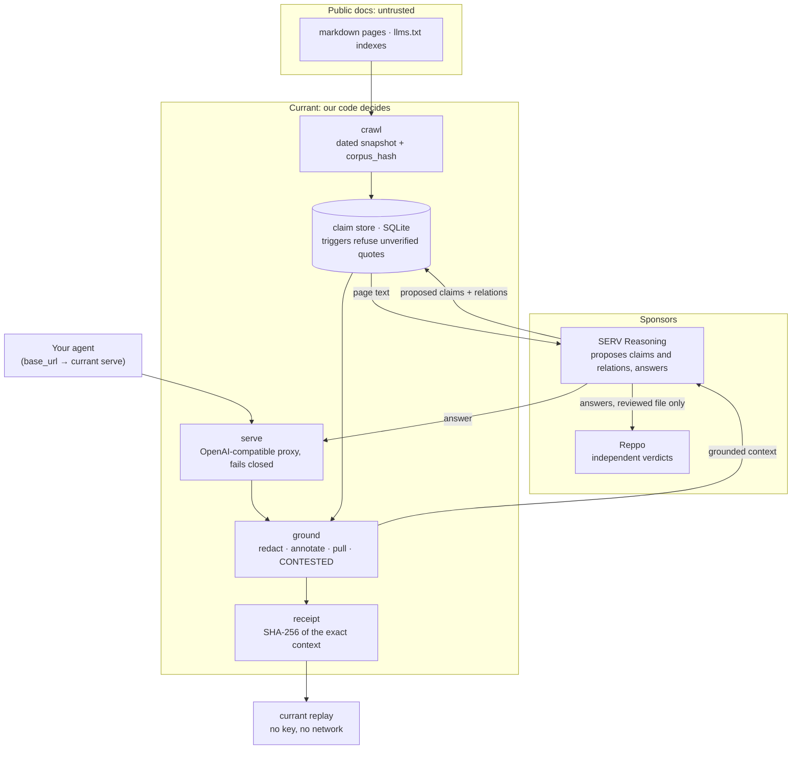
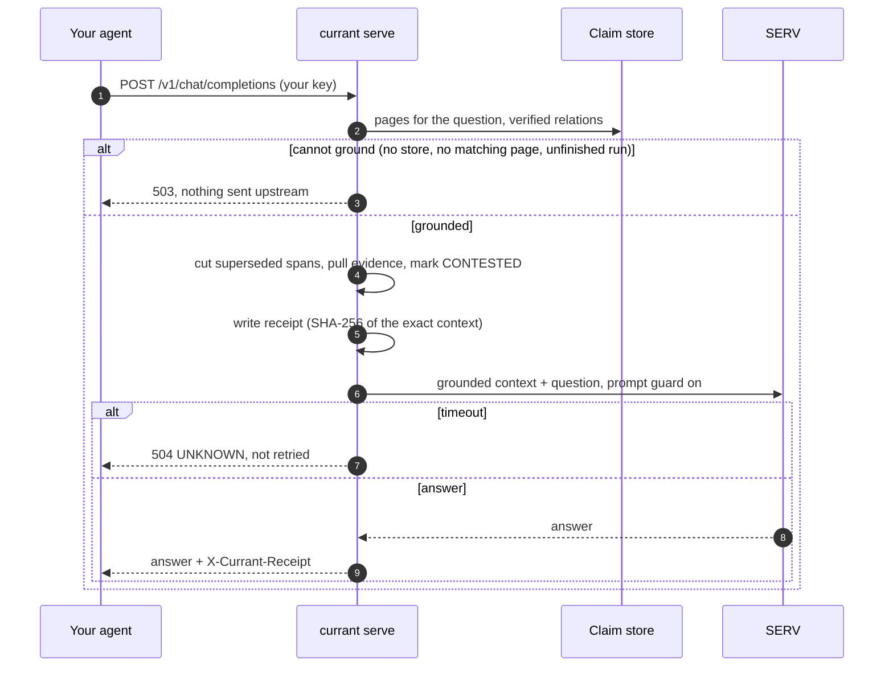

<div align="center">


# Currant

**Give your agent docs it can stand on, and a receipt that proves it.**

When the documentation disagrees with itself, Currant checks which claim won.

[](https://github.com/Dami904/currant/actions/workflows/ci.yml)
[](#tested-not-claimed)
[](LICENSE)
[](https://currant-firewall.vercel.app)
[](pyproject.toml)
[](https://www.openserv.ai)

**[Live site](https://currant-firewall.vercel.app)** · **[Demo in your browser](https://currant-firewall.vercel.app/#demo)** · **[How it works](https://currant-firewall.vercel.app/how.html)** · **[Judge it in 90 seconds](#judge-it-in-90-seconds)** · **[Found on real docs](#found-on-real-documentation)** · **[Where it lost](#where-it-lost)**

Built from scratch for the OpenServ + Reppo hackathon.

</div>

<!--
  DEMO VIDEO GOES HERE (under the header, before "The problem").
  On GitHub: edit README.md in the browser, drag the .mp4 into this spot, and GitHub
  inserts a https://github.com/user-attachments/assets/... link that plays inline.
  Then add a "Watch the demo" link to the header row and, if useful, a chapter table:
  | [0:00](url) | the problem | [0:30](url) | a receipt replays | [1:00](url) | where it lost |
-->

---

## The problem

You ask an agent about an API. It retrieves two pages. One says an evaluation costs 100 credits, the
other says 440, and nothing says which is current. The agent picks one, usually whichever ranked
first, and answers with total confidence. Afterwards nobody can tell which page it trusted, or
whether that page was already out of date.

Trusting "the newest page" doesn't fix it: pages rarely carry a reliable date, and a page can look
newer and still be the stale one. Deleting stale pages doesn't fix it either: a page that says
"previously 60, now 120" is exactly the page you want to keep.

## What Currant does

Before the model answers, Currant finds which claim was superseded (from the text alone, with no
labels), cuts that sentence, puts the winning evidence in front of the model, and returns a receipt
anyone can replay. One rule holds everywhere:

```text
nothing is cut, annotated or pulled   unless   our code found its quote, word for word, in the stored page
receipt.context_sha256                  ==      SHA-256 of the exact text the model was shown
```

The first line is enforced twice: in Python, and again by SQLite triggers that refuse to store an
unverified quote. The second is what `currant replay` recomputes, with no key and no network.

"Word for word" needs one precise footnote. The quote Currant stores, shows and hashes is always the
page's own bytes at the span, and that is re-checked every time a context is built. Finding *where*
the model's copy sits in the page tolerates two differences: runs of whitespace and a markdown
backslash escape (`\$` in the page, `$` in the copy). Re-checking the full extraction run's raw
model outputs with today's code, 1,023 claims pass every check and 12 of them (1.2%) are found only
that way; the rest are byte-for-byte copies. (The stored run kept 1,011: it predates the escape
rule.) `scripts/quote_exactness.py` recomputes this offline, and new runs flag such claims
`quote_matched_loosely`.

- **The model proposes; our code checks.** A model suggests claims and which one replaced which.
  Every quote it cites is searched for in the stored page; one that isn't there is thrown away.
- **Order comes from the text, never a guess.** A line saying one value replaced the other, or a
  different date printed on each page. Without that, the pair is **CONTESTED**, with both quotes.
- **Spans, not pages.** Only the superseded sentence is cut. A page's history survives.
- **Receipts anyone can replay.** Each records the hash of the exact context, the snapshot, the
  models, the prompt versions and every quote used.
- **Fails closed.** The proxy answers 503 and sends nothing upstream if it can't ground a question.
- **Works with any OpenAI-compatible agent.** Change one `base_url` to `currant serve`.

**The model reads. Our code checks. The receipt proves it.**

---

## Judge it in 90 seconds

**Live: [currant-firewall.vercel.app](https://currant-firewall.vercel.app).** The landing page
runs the demo in your browser: switch between the context *with* and *without* Currant, then press
**Recompute** to hash the text with your browser's own crypto and compare it with the receipt.
Press **Change one number** and watch it fail. The site is static; the full pipeline is the
command line below.

|                   |                                                                                                                                                   |
| ----------------- | ------------------------------------------------------------------------------------------------------------------------------------------------- |
| **1152**          | tests, all offline: a `conftest.py` makes any socket call fail                                                                                    |
| **0.857 / 0.828** | held-out precision and recall on 93 synthetic test items, scored once after a public freeze (dev was 1.000 / 0.892: a miss, reported as one)      |
| **3**             | real conflicts found in Reppo's own docs, reported upstream ([issue #11](https://github.com/Reppo-Labs/docs/issues/11), [PR #12](https://github.com/Reppo-Labs/docs/pull/12)) |
| **-7.7**          | Currant against baseline on those 3 questions in Reppo's own judges' scores (59.0 against 66.7): **we lost**, and [why is below](#where-it-lost) |

Replay a receipt yourself, with no key and no network:

```bash
uv sync
uv run currant replay examples/demo/receipt.json --db examples/demo/store.db
uv run python scripts/build_drift_page.py --check   # every quote below is verbatim in the snapshots
```

If `uv` is not on your PATH, use `python -m uv`.

---

## Contents

- [Found on real documentation](#found-on-real-documentation)
- [Sponsor tools in use](#sponsor-tools-in-use)
- [The core proof](#the-core-proof)
- [Architecture](#architecture)
- [How a question moves](#how-a-question-moves)
- [The lines that hold the line](#the-lines-that-hold-the-line)
- [Tested, not claimed](#tested-not-claimed)
- [Where it lost](#where-it-lost)
- [Engineering decisions](#engineering-decisions)
- [What's staged vs. real](#whats-staged-vs-real)
- [Live product surface](#live-product-surface)
- [Scope and limitations](#scope-and-limitations)
- [Tech stack](#tech-stack)
- [Project layout](#project-layout)
- [Run it locally](#run-it-locally)
- [Docs](#docs)

---

## Found on real documentation

Reppo publishes two descriptions of its own Evaluation API, and they disagree. Each row was checked
by a person against both pages and against what the live service did (an evaluation was charged
`creditsCharged: 440` on 2026-11-05 and again on 2026-11-11). Quotes are verbatim:

| Fact                           | `docs.reppo.ai` (stale)                                                 | `eval.reppo.xyz/agents.md` (current)                                       | Found by          |
| ------------------------------ | ----------------------------------------------------------------------- | -------------------------------------------------------------------------- | ----------------- |
| Cost of a text-only evaluation | "An evaluation costs 100 credits."                                      | "A text-only evaluation costs **440 credits**;"                            | Currant           |
| Sign-up bonus                  | "Sign-up bonus \| 1,000 credits (10 evaluations)"                       | "New accounts start with **22,000 credits** (a one-time sign-up bonus)."   | Currant           |
| Largest attachment             | "Attachments \| 1 per evaluation, up to 2 MB: PNG, JPEG, WebP, or PDF"  | "Max 1 item, 1.25 MB each"                                                 | Hand: the detector missed it |

All three are reported: [Reppo-Labs/docs issue #11](https://github.com/Reppo-Labs/docs/issues/11)
and a proposed fix, [pull request #12](https://github.com/Reppo-Labs/docs/pull/12). Neither has a
maintainer reply yet.

Three more, found later and published on 2026-11-15 (all still in that day's crawl):

| Fact                                  | Stale side                                                                 | Current side, and what confirms it                                                     | Found by          |
| ------------------------------------- | -------------------------------------------------------------------------- | -------------------------------------------------------------------------------------- | ----------------- |
| Which Reppo API exists                | `docs.reppo.ai` documents `POST …/agents/eval-requests/submit`             | `agents.md` lists it under "Removed endpoints"; the live server returns 404 for it     | Live probe        |
| SERV DeepSeek V4 models               | The SERV introduction and SDK migration pages still list `deepseek-v4-pro, deepseek-v4-flash` | The changelog removed them; the live `/v1/models` list has no DeepSeek (2026-11-15) | Hand              |
| OpenServ SDK default `PORT`           | "`PORT` is optional (defaults to 7380)."                                   | "\| `PORT` \| Server port \| No \| 7378 \|" (which is right is not measured)            | Currant           |

All are minor documentation errors, not security issues. The detector flagged 7 pairs in all on
the 2026-11-05 snapshot. Of the 6 on Reppo's pages: 2 live conflicts, 2 already resolved by
removal, 2 false positives; the 7th is the OpenServ `PORT` pair. The reasoning for each is in
[`docs/drift/REPPO_EVAL_API.md`](docs/drift/REPPO_EVAL_API.md) and
[`docs/drift/OPENSERV_DOCS.md`](docs/drift/OPENSERV_DOCS.md), which `scripts/build_drift_page.py`
rebuilds and refuses to write if a quote isn't verbatim in the committed snapshots.

---

## Sponsor tools in use

Both do real work, and each row points at the code and at evidence you can open.

| Tool                                  | What Currant uses it for                                                                                                                                                                                                    | Code                                                                                                         | Evidence                                                                                |
| ------------------------------------- | --------------------------------------------------------------------------------------------------------------------------------------------------------------------------------------------------------------------------- | ------------------------------------------------------------------------------------------------------------ | --------------------------------------------------------------------------------------- |
| **SERV Reasoning, by OpenServ**       | Every model call: proposing claims, proposing which claim replaced which, and answering, with one model, `gpt-6-luna`. Crawled text reaches it only behind `serv_prompt_guard`; the guard can fail open, so the checks that matter run in our code. | [`serv.py`](src/currant/serv.py) · [`extract.py`](src/currant/extract.py) · [`detect.py`](src/currant/detect.py) | 132 pages read, 1,011 claims stored of 1,160 proposed ([`results/`](results/))           |
| **Reppo Evaluation API**              | Independent verdicts: Reppo's judges scored our answers against a baseline with no firewall, 21 public evaluations on 2026-11-12 (9,240 credits), and a re-audit of the fixed contested answer on 2026-11-15 (7 new evaluations, 3,080 credits). A submission goes out only from a file a person reviewed, matched by its SHA-256. | [`reppo.py`](src/currant/reppo.py) · [`reppo_audit.py`](src/currant/reppo_audit.py)                           | the verdicts, raw ([`results/audit/`](results/audit/))                                   |

---

## The core proof

> _"What are the API rate limit and the maximum upload size?"_

The committed demo (`examples/demo/`) is built from invented pages on `docs.example.com`. Two of them
disagree about the upload size, and an older page gives a rate limit that a changelog says was
replaced. This is the context Currant hands the model, and the command that proves it, verbatim:

```text
$ uv run currant replay examples/demo/receipt.json --db examples/demo/store.db
REPLAY OK: the context hash recomputes to cd5ee7e3aae56daadf9ae89c2a15aac9a2fdf14cc6cdda73ca76a0ea2ad14a69

$ cat examples/demo/context.txt
<<<NOTICE: CONTESTED>>>
These sources disagree and nothing in them shows which is current. Do not pick a winner; report both.
- https://docs.example.com/faq.md: "Uploads can be up to 25 MB."
- https://docs.example.com/limits.md: "Uploads can be up to 10 MB."
<<<END NOTICE>>>
<<<DOCUMENT 1: https://docs.example.com/limits.md>>>
# Limits

Rate limits and uploads.

[REMOVED: superseded by newer documentation]

Uploads can be up to 10 MB.

<<<END DOCUMENT 1>>>
<<<DOCUMENT 2: https://docs.example.com/faq.md>>>
# FAQ

Uploads can be up to 25 MB.

<<<END DOCUMENT 2>>>
<<<PULLED EVIDENCE>>>
- https://docs.example.com/changelog.md: "Each API key may make 120 requests per minute."
<<<END PULLED EVIDENCE>>>
```

1. **`[REMOVED: superseded by newer documentation]`** is where the page said "Each API key may make 60
   requests per minute." Only that sentence was cut; the upload limit on the same page survives.
2. **`PULLED EVIDENCE`** is the newer value, 120, from a changelog that also says "This replaces the
   previous value of 60 in earlier documentation." That sentence is the evidence for the order, and
   the receipt stores it beside the claim.
3. **`NOTICE: CONTESTED`** covers the two upload sizes. Nothing in either page says which is newer,
   so Currant shows both quotes and refuses to pick.
4. **`REPLAY OK`**: replay rebuilds the context from the claim store, re-checks every quote against
   the stored page and recomputes the hash. One changed character fails it.

---

## Architecture



| Layer            | Owns                                                                                                                       |
| ---------------- | -------------------------------------------------------------------------------------------------------------------------- |
| **Crawler**      | Dated snapshots with content hashes; every redirect hop re-checked against an allow-list; a timeout is UNKNOWN, not failed |
| **Claim store**  | Verbatim quotes, verified-only relations, append-only history, all enforced by the database itself                         |
| **Detector**     | Candidate pairs, the model's verdict, then our verification and the direction                                              |
| **Grounder**     | The context the model sees: cut spans, pulled evidence, CONTESTED notices                                                  |
| **Receipts**     | The hash of that context, and every quote behind it, so anyone can replay it                                               |
| **SERV**         | Reading and answering; never the final word on what is true                                                                |
| **Reppo**        | An outside judge of the answers                                                                                            |

| Path                                                                                                                  | Role                                                                     |
| --------------------------------------------------------------------------------------------------------------------- | ------------------------------------------------------------------------ |
| [`src/currant/crawl/`](src/currant/crawl)                                                                             | Fetch, snapshot and verify                                               |
| [`extract.py`](src/currant/extract.py), [`serv.py`](src/currant/serv.py)                                              | Claim extraction; the SERV client with the prompt guard                  |
| [`store.py`](src/currant/store.py), [`store_schema.py`](src/currant/store_schema.py)                                  | The claim store and the triggers that enforce the invariants             |
| [`detect.py`](src/currant/detect.py)                                                                                  | Candidates, the model's verdict, our verification and direction          |
| [`ground.py`](src/currant/ground.py), [`receipt.py`](src/currant/receipt.py)                                          | Redact, annotate, pull, CONTESTED, and replayable receipts               |
| [`proxy.py`](src/currant/proxy.py), [`proxy_http.py`](src/currant/proxy_http.py), [`web/`](src/currant/web)           | The grounding proxy and the receipt viewer                               |
| [`reppo.py`](src/currant/reppo.py), [`reppo_run.py`](src/currant/reppo_run.py), [`reppo_audit.py`](src/currant/reppo_audit.py) | Reppo client with a ledger so an unknown submit is never resent; the audit |
| [`evalset.py`](src/currant/evalset.py), [`harness/`](src/currant/harness)                                             | Sealed evaluation items, the runners and the scorer                      |
| [`guardrails.py`](src/currant/guardrails.py)                                                                          | Repo rules enforced as code, run in CI                                   |
| [`site/`](site)                                                                                                       | The landing site (Vite, TypeScript)                                      |

---

## How a question moves



### How it decides, case by case

| Situation                                                                 | Outcome                                                                     |
| ------------------------------------------------------------------------- | --------------------------------------------------------------------------- |
| A quote the model cited is not in the page                                | Proposal discarded                                                          |
| One page says "this replaces the previous value of 60" and the other holds 60 | The 60 sentence is cut; the 120 sentence and the ordering quote are pulled in |
| Each page carries a different ISO date                                    | The later-dated page wins                                                   |
| Both pages carry the same date                                            | Not ordered: CONTESTED                                                      |
| Two values differ and nothing says which is current                       | CONTESTED notice with both quotes; nothing cut                              |
| A page says "previously X, now Y"                                         | The page survives; only a superseded span is ever cut                       |
| The proxy cannot ground                                                   | 503, and nothing is sent upstream                                           |
| A step times out                                                          | UNKNOWN: recorded and reconciled later, never counted as failed             |

---

## The lines that hold the line

Python checks every quote, but the final word belongs to the database. A claim whose quote isn't the
exact text at its position in the page cannot be stored, and a supersession cannot be marked
verified without verbatim evidence for the older claim, the newer claim and the order
([`src/currant/store_schema.py`](src/currant/store_schema.py)):

```sql
CREATE TRIGGER claims_guard BEFORE INSERT ON claims
BEGIN
    -- ...the run must be running, and the page must be in its snapshot...
    SELECT RAISE(ABORT, 'quote is not verbatim document text at [start, end)')
    WHERE substr((SELECT text FROM documents WHERE doc_id = NEW.doc_id),
                 NEW.start_char + 1, NEW.end_char - NEW.start_char) IS NOT NEW.quote;
END;

-- in relations_guard, before a relation may become verified:
    SELECT RAISE(ABORT, 'supersedes needs verified older, newer and ordering evidence')
    WHERE NEW.status = 'verified' AND NEW.kind = 'supersedes' AND NOT ( ... );
```

- **History is append-only.** Documents, snapshots, claims, evidence and events can't be edited or
  deleted; relations and runs can't be deleted, and a relation moves only from proposed to verified
  or rejected.
- **Pages are content-addressed.** A page's id is the SHA-256 of its bytes, as in the crawl manifest.
- **Labels never reach the pipeline.** Pipeline code never imports `currant.evalset`; a guardrail
  fails CI if it does.

---

## Tested, not claimed

**1152 tests pass, all offline.** A `conftest.py` makes any socket call fail, so no test can reach
the network; every external API is exercised through `httpx` mock transports and scripted replies.
Every guard ships with a test that fails when the guard is removed.

| Proof                                           | Test                                                                                                                                                                                  |
| ----------------------------------------------- | ------------------------------------------------------------------------------------------------------------------------------------------------------------------------------------- |
| The database refuses an unverified quote        | `test_the_database_itself_rejects_a_claim_whose_quote_is_not_in_the_document` ([`test_store.py`](tests/test_store.py))                                                               |
| History can't be rewritten                      | `test_history_cannot_be_rewritten_or_deleted` ([`test_store.py`](tests/test_store.py))                                                                                                |
| A cut removes a sentence, never a page          | `test_redact_removes_only_the_stale_sentence_not_the_page` ([`test_ground.py`](tests/test_ground.py))                                                                                 |
| No evidence of order means no cut               | `test_unverifiable_ordering_is_downgraded_to_contradicts_never_to_a_cut` ([`test_detect.py`](tests/test_detect.py))                                                                   |
| A forged receipt is caught                      | `test_a_changed_receipt_is_caught_even_when_the_forger_recomputes_the_id` ([`test_receipt.py`](tests/test_receipt.py))                                                                |
| The proxy fails closed                          | `test_a_request_that_cannot_be_grounded_is_refused_and_never_sent_upstream` ([`test_proxy.py`](tests/test_proxy.py))                                                                  |
| A timeout is unknown and never retried          | `test_an_upstream_error_passes_through_and_a_timeout_is_unknown_and_not_retried` ([`test_proxy.py`](tests/test_proxy.py))                                                              |
| Nothing goes to Reppo without a reviewed file   | `test_nothing_is_sent_unless_the_hash_of_the_reviewed_file_is_given` ([`test_reppo_run.py`](tests/test_reppo_run.py))                                                                 |
| An unknown submission is never resent blindly   | `test_an_unknown_submit_blocks_every_later_submit_until_resolved` ([`test_reppo.py`](tests/test_reppo.py))                                                                             |
| The dev/test split is pinned                    | `test_the_rule_is_pinned`, `test_golden_assignments` ([`test_evalset.py`](tests/test_evalset.py))                                                                                      |
| The landing pages tell the truth                | every quotation verbatim from the checked data, every figure also in these docs, nothing loaded from elsewhere ([`test_site.py`](tests/test_site.py))                                  |
| No test can reach the network                   | [`test_network_blocked.py`](tests/test_network_blocked.py)                                                                                                                             |
| Two equal values are never a supersession       | `test_two_claims_with_the_same_number_are_never_a_supersession_or_a_conflict` ([`test_detect.py`](tests/test_detect.py)) |
| Blocking finds exactly the pairs all-pairs finds | `test_blocking_returns_exactly_the_all_pairs_result` (property test, 1,500 cases) ([`test_blocking.py`](tests/test_blocking.py)) |
| The proxy denies data without its token          | `test_with_a_token_configured_data_routes_deny_by_default` ([`test_proxy_gate.py`](tests/test_proxy_gate.py)) |
| Every named guard is caught when removed        | `scripts/mutation_check.py`: 34 of 34 mutants caught, run in CI |
| A receipt built from real docs replays           | `currant replay examples/real/receipt.json` runs in CI ([`examples/real/`](examples/real/README.md)); the site's [receipt check](https://currant-firewall.vercel.app/verify.html) recomputes its hash in the browser |

### What we measured

| Measure                                                     | Dev                 | Held out (93 synthetic test items, scored once after the freeze) |
| ----------------------------------------------------------- | ------------------- | ----------------------------------------------------------------- |
| Precision on cuts                                           | 1.000 (33 cuts)     | **0.857** (28 cuts)                                               |
| Recall                                                      | 0.892 (33 of 37)    | **0.828** (24 of 29)                                              |
| Cuts on clean controls                                      | 0 of 54             | 0 of 46                                                           |
| Right answer when only the stale page was retrieved         |                     | **84.2%** with `pull` or `annotate`, against 0% without           |
| Right answer when both pages were retrieved                 |                     | 100% in every arm: no lift                                        |

Dev numbers are optimistic: each detector rule was written after reading a dev failure. The test
labels stayed sealed until a public freeze on 2026-11-11 (commit root and code fingerprint in
[issue #1](https://github.com/Dami904/currant/issues/1)), and the held-out result is a miss against
dev, reported as one. All 202 labels are now published with their salts in
[`results/labels/`](results/labels/), and `tests/test_published_labels.py` recomputes every
commit and the root posted in issue #1, so a label changed after the freeze fails CI.

---

## Where it lost

Reppo's own judges scored our answers against a baseline with no firewall (`results/audit/`, one
judgement per question):

| Set                    | Baseline | Currant (`pull`) | Reading                                                              |
| ---------------------- | -------- | ---------------- | -------------------------------------------------------------------- |
| 15 easy numeric facts  | 100      | 100              | Identical answers: no harm, and no room to show a lift               |
| Cost conflict          | 81       | 36               | **We lost:** "contested" named neither value                         |
| Sign-up bonus conflict | 53       | 71               | Judges credited spotting the contradiction                           |
| Attachment conflict    | 66       | 70               | Detector missed it, so both gave the stale 2 MB                      |
| **3 real conflicts**   | **66.7** | **59.0**         | **-7.7**, interval -45 to +18 over 3 questions: no conclusion        |

**Why we lost points on cost:** when two pages disagree and nothing orders them, the answer says
only that the documentation is contested. It named neither value; the judges marked it incomplete
and preferred a confident "440" that matched the live charge. Since fixed in `answer-v2`: a
contested answer now lists every value the CONTESTED notice quotes, and our code drops any value
not written in those verified quotes. The scores above are `answer-v1`'s and stay as recorded.

**Re-audit of `answer-v2`** (2026-11-15, `results/audit/reppo-conflicts-v2.jsonl`). The same three
Reppo conflicts plus one in the OpenServ docs (default `PORT`, 7380 vs 7378), with the same
reference section as v1. 7 new evaluations (3,080 credits): the attachment-size baseline answer was
byte-identical to v1's, so the ledger reused its 2026-11-12 verdict instead of paying for it again.

| Question                | Baseline | Currant (`pull`) | Judges' reason, in short                                        |
| ----------------------- | -------- | ---------------- | --------------------------------------------------------------- |
| Cost per evaluation     | 91       | 77               | **Lost again:** they preferred "440", which matches the live charge |
| Sign-up bonus           | 78       | 100 (`ship`)     | Credited for surfacing both values                              |
| Attachment size         | 66       | 58               | **Lost:** named no value (fixed since in `answer-v3`, see below) |
| OpenServ default `PORT` | 70       | 100              | Credited for surfacing both values                              |
| **4 conflicts**         | **76.2** | **83.8**         | **+7.5**, interval -11 to +26 over 4 questions: no conclusion   |

Better on 2, worse on 2. Listing both values fixed the questions where neither page is backed by
anything else; it still loses when one value matches what the live service does, which text alone
cannot know.

**Why attachment size named nothing, and the fix (`answer-v3`, not re-audited):** the detector
never found that pair. The pages' CONTESTED notice was about other facts (cost, sign-up bonus), the
model still answered "contested" and read 1.25 MB and 2 MB from the page text, and our check, which
only accepted numbers inside the notice, dropped both. Now, when no value is in a notice, a value is
kept if its number is written in the text of the page it cites; two different pages must give
different numbers; and the answer says the model reports these values and that Currant has not
verified a conflict. That check is weaker than a notice: it does not prove the two numbers describe
the same fact, or that one page is not simply older.
Replayed offline on the real c03 reply, it now names 1.25 MB (agents.md) and 2 MB (evaluations.md).

---

## Engineering decisions

- **The model proposes; our code checks.** Models paraphrase and misremember. Requiring a verbatim
  quote that our own code locates means an invented claim can't change a context. Recall suffers;
  safety doesn't.
- **The database enforces the rule too,** so a bug in the Python can't store an unverified quote.
- **Cut spans, not documents.** Deleting a stale page also deletes the "previously X, now Y" line
  that explains the change.
- **CONTESTED over a guess.** A confident wrong answer is worse than an honest "these disagree".
  It cost us points in the Reppo audit, and we report that as a loss.
- **A timeout is UNKNOWN, never FAILED.** Only read-only or provably idempotent calls retry. A Reppo
  submission that timed out may have been charged, so the ledger records it and it is never resent
  blindly.
- **Sealed labels and one public freeze.** Held-out items were scored once; pipeline code can't
  import the labels.
- **Crawled text is data, not instructions.** It reaches a model only behind SERV's prompt guard,
  and every decision that matters is re-checked in our code.
- **One runtime dependency,** `httpx`.

---

## What's staged vs. real

- **The demo is staged on purpose.** `examples/demo/` uses invented pages on `docs.example.com` and
  hand-written claims, so it's deterministic and a stranger can reproduce it end to end
  (`scripts/build_demo.py` gives the same receipt id every time). It shows the mechanism, not how
  well the detector does on real documentation.
- **The synthetic evaluation items are generated:** 199 items (99 injected supersessions, 100 clean
  controls), plus 3 real-documentation items from Reppo's docs, labelled by a separate AI session
  that saw only the quoted text and checked by a person. Those 3 are dev items.
- **Everything else is a live run.** The crawl (132 pages, 0 errors), the extraction (1,011 claims
  stored of 1,160 proposed), the relation runs, the held-out scoring and the Reppo audits (21
  evaluations, 9,240 credits, then a re-audit of 7 new evaluations, 3,080 credits) ran against the real
  services. Raw outputs are in `results/` with keys
  scrubbed; the raw logs of the relation step stay local (`results/relate/` is git-ignored).
- **A slice of Stripe's public docs** (2026-11-12) ran with no code change: 59 pages, 463 claims
  verified of 611 proposed, and no real documentation error found. That shows it runs elsewhere,
  not that it works there.
- **The Kite docs** (`docs.gokite.ai`, 2026-11-15) also ran with no code change: 76 pages, 484
  claims verified of 526 proposed. Detection there **failed, safely**: 33 contradictions, 32 of them
  dated changelog pages naming each release's versions (history, not conflict) and one a testnet
  against a mainnet chain ID. Nothing was cut, but an agent would see false CONTESTED notices. The
  49 candidate pairs were labelled by two separate model sessions, not a person; both found no real
  conflict, so Kite gave no evaluation items. Not tuned away; details in
  [LIMITATIONS](docs/LIMITATIONS.md#a-third-documentation-site-2026-11-15).

---

## Live product surface

| Route                                                                      | What it shows                                                                                                         |
| -------------------------------------------------------------------------- | --------------------------------------------------------------------------------------------------------------------- |
| [`/`](https://currant-firewall.vercel.app)                                 | The problem, the three steps, the in-browser demo and receipt replay, guarantees, the real conflicts, results, integration, FAQ |
| [`/how.html`](https://currant-firewall.vercel.app/how.html)                | The six-step pipeline, three ways to use it, the demo receipt field by field, what's not built, the full FAQ          |
| `currant serve` → `POST /v1/chat/completions`                              | The grounding proxy (localhost)                                                                                       |
| `currant serve` → `GET /`                                                  | The receipt viewer: every receipt, its exact context, and its replay result                                             |
| `currant serve` → `GET /receipts/<id>/replay`                              | Re-ground from the store and compare the context hash                                                                 |

---

## Scope and limitations

- **The held-out result has no real documentation in it,** and the effect on answers is measured
  only on synthetic items with one model (`gpt-6-luna`). Lift appears only when the newer page
  wasn't retrieved.
- **On real documentation the detector is a lead generator, not a verdict.** A person confirmed each
  real conflict, threw out the false positives, and found the one it missed.
- **Receipt signing is optional and has no key directory.** `currant sign` adds an Ed25519 signature (`uv sync --extra sign`), and `verify-signature` checks it against a public key *you* supply. There is no revocation, no expiry, and no published registry of keys. Only `examples/real/` is signed; CI verifies it.
- **Retrieval isn't wired into `currant ground`,** which takes the pages you name (the proxy does
  retrieve). A paid x402 endpoint isn't built.
- **A second detector model does worse, and the guards don't fully catch it.** On dev items,
  `claude-haiku-4.5` as the detector (same claims) scored precision 0.941 against 1.000 for
  `gpt-6-luna`. Its 2 wrong cuts used verbatim quotes attached to the wrong attribute. It also
  exposed a missing guard (a "supersession" between equal values), fixed in `detect-v3`.
- **Crawl-diff is small.** `currant crawl-diff` and `currant as-of` work across three snapshots,
  but they found one verified change (Reppo's decision values), and recall is capped by extraction.
- **Pairing still grows about quadratically** on synthetic claims with common words (161 s at
  10,000 claims); on the real run blocking is 0.9 s against 5.1 s for all pairs, with identical output.
- **The crawler reads markdown and `llms.txt` indexes only;** HTML pages are refused.
- **Streaming isn't supported** by the proxy, and only the last user message is grounded.

The full list is in [`docs/LIMITATIONS.md`](docs/LIMITATIONS.md); who is trusted and what a
compromised key allows is in [`docs/THREAT_MODEL.md`](docs/THREAT_MODEL.md).

---

## Tech stack

- **Core:** Python 3.12 · `uv` (lockfile committed) · `httpx` (the only runtime dependency)
- **Storage:** SQLite, with triggers that enforce the claim-store invariants; FTS5 for retrieval
- **Model:** SERV Reasoning by OpenServ (`gpt-6-luna`) with `serv_prompt_guard`
- **Verdicts:** Reppo Evaluation API
- **Checks:** `ruff` · `mypy --strict` · `pytest` (1152 tests) · `hatchling`; GitHub Actions runs each as its own job, with actions pinned to commit SHAs
- **Site:** Vite · TypeScript · pnpm; no runtime dependencies, no external requests; hosted on Vercel

---

## Project layout

```text
currant/
├─ src/currant/
│  ├─ cli/                the commands, one module per group (currant --help lists them)
│  ├─ config.py           the only file that reads API keys
│  ├─ crawl/              urls, config, index, fetch, snapshot, runner
│  ├─ store.py            the claim store; store_schema.py holds its triggers
│  ├─ extract.py          claim extraction; serv.py is the SERV client
│  ├─ detect.py           relation detector: candidates, model verdict, our verification
│  ├─ crawldiff.py        supersession from two dated crawls of the same URL
│  ├─ ground.py           redact / annotate / pull / CONTESTED; receipt.py makes receipts
│  ├─ signing.py          optional Ed25519 signatures for receipts
│  ├─ retrieve.py         BM25 page retrieval over a snapshot
│  ├─ proxy.py            the grounding proxy; proxy_http.py serves it; web/ is the viewer
│  ├─ reppo*.py           Reppo client, ledger, audit runner and report
│  ├─ drift.py            the private drift report
│  ├─ llmcache.py         the model-reply cache; obs.py is structured logging
│  ├─ evalset.py          sealed evaluation items; harness/ runs and scores them
│  └─ guardrails.py       repo rules that fail CI
├─ tests/                 offline tests (sockets blocked)
├─ examples/demo/         a small deterministic store and receipt anyone can replay
├─ examples/real/         a signed receipt over real Reppo pages, replayed in CI
├─ site/                  the landing site
├─ snapshots/             crawled third-party docs, hashed (not MIT; see its README)
├─ results/               raw outputs of live runs, keys scrubbed; audit/ Reppo's verdicts, labels/ the 202 frozen labels
├─ scripts/               live_* smoke tests (never run by CI), build_demo.py, build_drift_page.py, mutation_check.py
├─ docs/                  API notes, claim store, limitations, threat model, drift/, brand/
├─ .github/               CI (each check its own job) and Dependabot
└─ TIMELINE.md            what happened on which date, each backed by a committed file
```

---

## Run it locally

Needs [`uv`](https://docs.astral.sh/uv/). No API keys, and the tests never touch the network.

```bash
git clone https://github.com/Dami904/currant && cd currant
uv sync

# The main checks CI runs (CI also runs pip-audit and the site build)
uv run ruff check . && uv run ruff format --check . && uv run mypy
uv run pytest --cov=currant --cov-branch --cov-fail-under=92
uv build
uv run python -m currant.guardrails        # repo rules enforced as code
uv run python scripts/mutation_check.py    # remove each named guard; a test must fail
uv run python scripts/build_drift_page.py --check
for d in snapshots/*/; do uv run currant verify "$d"; done

# Replay a receipt (no key, no network)
uv run currant replay examples/demo/receipt.json --db examples/demo/store.db
uv run currant replay examples/real/receipt.json --db examples/real/store.db
uv run currant verify-signature examples/real/receipt.json --public-key "$(cat examples/real/signing-public-key.txt)"
uv run python scripts/build_demo.py --out build/again  # same receipt id every time

# The landing site
cd site && pnpm install && pnpm dev        # http://127.0.0.1:5173
```

The full pipeline needs `SERV_API_KEY` in the environment, uses the network and costs model
credits. Its outputs live in `data/`, which isn't committed:

```bash
uv run currant extract --snapshot snapshots/2026-11-05     # claims, one model call per page
uv run currant relate --extract-run 1                      # which claims replace or contradict
uv run currant ground --extract-run 1 --relate-run 2 \
    --url <page> --url <page> --question "..." --out receipt.json --context-out ctx.txt
uv run currant serve --extract-run 1 --relate-run 2        # grounding proxy + receipt viewer
```

Run it on your own docs (any site that serves markdown or an `llms.txt` index). Check the site's
`robots.txt` and terms first, and tell the maintainers before publishing anything it finds:

```bash
uv run currant crawl --config my-docs.toml --out data/mine --corpus mine
uv run currant extract --snapshot data/mine/<date> --db data/mine.db
uv run currant relate --db data/mine.db --extract-run 1
uv run currant drift-report --db data/mine.db --extract-run 1 --relate-run 2 --out mine.md
```

Reppo evaluations are **public**: `currant reppo-audit submit` refuses to send anything without the
SHA-256 of the exact submissions file you reviewed.

---

## Docs

- **[How it works](https://currant-firewall.vercel.app/how.html)**: the pipeline, three ways to use it, the receipt field by field, FAQ
- [`docs/LIMITATIONS.md`](docs/LIMITATIONS.md): what isn't handled yet, stated plainly
- [`docs/THREAT_MODEL.md`](docs/THREAT_MODEL.md): who is trusted, and what each compromised key allows
- [`docs/API_NOTES.md`](docs/API_NOTES.md): measured behaviour of SERV and Reppo
- [`docs/CLAIM_STORE.md`](docs/CLAIM_STORE.md): the claim store's design
- [`docs/EVALUATION_ITEMS.md`](docs/EVALUATION_ITEMS.md): how evaluation items are built, split and sealed
- [`TIMELINE.md`](TIMELINE.md): what happened on which date, and the file that shows it
- [`docs/drift/`](docs/drift): the public lists of documentation conflicts found in the Reppo and OpenServ docs
- [`docs/brand/`](docs/brand): the logo files

## Attribution

[SERV Reasoning](https://www.openserv.ai) by OpenServ for every model call, and
[Reppo](https://eval.reppo.xyz) for independent verdicts. [httpx](https://www.python-httpx.org)
(BSD-3-Clause) is the only runtime dependency; the site uses [Vite](https://vite.dev) (MIT) and
[TypeScript](https://www.typescriptlang.org) (Apache-2.0). Built with
[Claude Code](https://claude.com/claude-code).

## License

[MIT](LICENSE) for Currant's own code and docs. The crawled documentation in `snapshots/` is
third-party content and isn't covered by it; see [`snapshots/README.md`](snapshots/README.md).

---

<div align="center">

**Retrieval finds the pages. Currant tells your agent which one still holds.**

</div>
