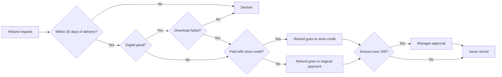
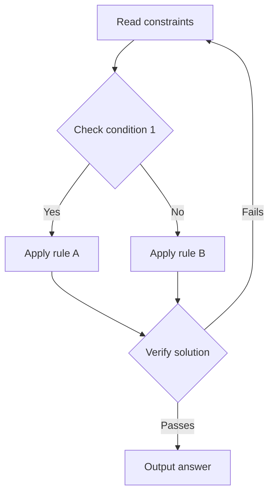
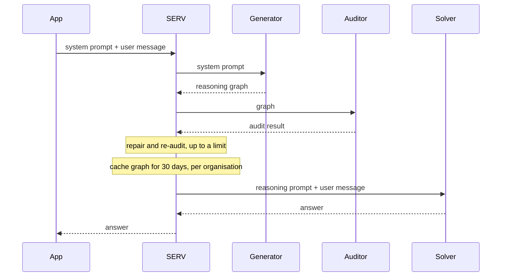

> ## Documentation Index
> Fetch the complete documentation index at: https://docs.openserv.ai/llms.txt
> Use this file to discover all available pages before exploring further.

# The Reasoning Problem

> Why free-form chain of thought is the wrong medium for reasoning, and what a bounded graph does differently.

Since 2022 we have been paying models to talk to themselves. It started as a prompting trick. You add "let's think step by step" and accuracy on maths word problems jumps ([Kojima et al., 2022](https://arxiv.org/abs/2205.11916)). In September 2024 OpenAI shipped o1 with the trick trained in, called the output "reasoning tokens", and billed them as output. The other labs followed. Today most hosted APIs return a summary of the trace or nothing at all, and you pay for the full trace either way. Anthropic's docs say that omitting the thinking reduces latency, not cost. The effort knob you are given is guidance the model may ignore. Among hosted APIs DeepSeek is the exception and returns the whole chain, and any open-weight model returns it when you run it yourself.

I think the value is in the structure the monologue accidentally produces, and prose holds structure badly.

## Watching a model lose the thread

Watch a model reason in free text about a refund policy with four conditions. It writes the first condition, checks it, writes the second, gets halfway through the third and refers back to "the earlier point" without saying which. By condition four it has restated the rules twice, slightly differently each time, and the answer depends on which restatement it happened to trust last. The tokens went on bookkeeping that prose cannot do well.

I see the same shape in the agent failures people post on Hacker News and in my own pipeline. The model knew the rule and lost track of it. Someone writes a careful system prompt with routing rules, exceptions, and a priority order. It works on the happy path. Then a request arrives that touches two rules at once, and the model picks one, forgets the other, and produces a confident answer that violates the prompt it was given. The prompt was fine, but the model had to hold the whole structure in a linear stream of text while also producing the answer, and linear text is bad at holding structure. A June 2026 paper on instruction hierarchies splits this into three failures I recognise from my own traces: not finding the relevant rule, not resolving the conflict, and resolving it correctly in the reasoning and then violating it in the output ([Where Instruction Hierarchy Breaks](https://arxiv.org/abs/2606.07808)).

The same failure shows up smaller in an agent I run that tags Hacker News stories with topics. Asked to tag 100 stories, it produced about 90 distinct labels, many of them near-duplicates like "AI", "AI models" and "Machine learning". The model understood every story. It had no structure to hold the label set steady across 100 decisions. I seeded a closed list of broad categories and required the first label to come from that list, which fixed most of it with the same model.

Compare that to how a person writes down a policy when they need to apply it many times. They draw a flowchart. Here is the refund policy from above, first as the prose a system prompt would carry, then as the person would draw it.

> Refunds are allowed within 30 days of delivery. Digital goods are non-refundable unless the download failed. Orders paid with store credit are refunded to store credit only. Any refund over 200 needs a manager to approve it before it is issued.

Conditions become diamonds, actions become boxes, and the arrows carry the order so the reader does not have to. The flowchart shows that the store-credit rule is settled before the approval rule, and that a failed digital download still passes through both. The prose leaves that order to the reader, and it also hides whether every branch has an exit. Neither a person nor a model can check that by reading the paragraph.

## The standard fix makes it worse

When a prompt like that fails in production, the fix I see most often is to buy a bigger model or turn up the effort setting and hope. It sometimes helps, and it adds more prose to a problem caused by prose. You pay for the extra tokens on every request, forever, and on a hosted API you still cannot read what the model did.

More reasoning tokens do not buy proportionally more accuracy, and past a point they buy less. Simon Willison measured Qwen 3.8 spending 22,276 reasoning tokens to produce 3,223 output tokens on a trivial task at its default setting ([Willison, August 2026](https://simonwillison.net/2026/Aug/16/qwen-38-27b/)). A study of test-time compute scaling found that extended reasoning makes models abandon answers they already had right ([Zhou et al., 2026](https://arxiv.org/abs/2604.10739)), and a mechanistic study found tokens past roughly 70 to 85% of a chain have minimal or negative effect ([Ye et al., 2026](https://arxiv.org/abs/2602.11201)). OpenAI, Anthropic and Google now all describe reasoning as adaptive in their API docs, so the model decides how much to think and you pay for whatever it decides.

Noam Brown at OpenAI argues the opposite direction for hard research problems, where capability keeps rising with inference compute and current models can think for weeks before plateauing ([No Priors, June 2026](https://www.youtube.com/watch?v=AZrU6y3pUcU)). I have no reason to doubt that. The tasks I am talking about are the ones most production systems are made of, with stable instructions, varying inputs, and a decision at the end. For those, you are mostly paying for the model to re-read its own notes.

In my experience most agent reliability problems are control-flow problems. The harness, the prompt and the model are one system, and swapping one part changes the others. Dex Horthy, who wrote 12 Factor Agents, put it as "don't use prompts for control flow" in a talk this year ([AI Tinkerers, March 2026](https://www.youtube.com/watch?v=c630qv03i8g)).

## Bounded reasoning

The alternative I have been using is the idea behind BRAID ([arXiv:2512.15959](https://arxiv.org/abs/2512.15959), December 2025). My colleagues at OpenServ wrote the paper, and the approach became SERV Reasoning, the product I build agents on. Instead of letting the model think out loud, you have a generator model produce a bounded reasoning graph as a Mermaid diagram: steps, branches, checks, and a verification loop. Then that diagram becomes the system context for a solver model that produces the answer.

A simplified version looks like this:

The graph is compact and gives the model far less room to drift, because there is no restated rule to trust over another. When the solver reaches the diamond it has to pick a branch, and when it picks a branch the next step is already written down.

The idea is not new. Plan-and-Solve and Graph of Thoughts made related arguments in 2023. FlowBench tested the same workflow knowledge as text, code and flowchart in 2024 and found the flowchart format performed best, because it let the model pinpoint its current state ([Xiao et al., 2024](https://arxiv.org/abs/2406.14884)). COVENANT compiles prose workflow instructions into a control-flow graph and reports the skipped-step and wrong-branch failures dropping from 42.5% to 15.8% of cases ([Wang et al., July 2026](https://arxiv.org/abs/2607.25400)). BRAID's contribution is the specific format, a Mermaid graph the model writes itself, and the cost measurements.

People in these threads raise an objection I take seriously, that chain-of-thought tokens work partly as extra compute rather than as content the model reads back. If so, a graph in the system prompt is a better input, and the solver's own hidden reasoning still happens and is still billed. I think that is true. The graph gives the monologue something to hold on to, and it lets you use a solver whose monologue is short and cheap.

Nor does the graph make the model deterministic, and I do not think anything will. I think that if the same input gives two answers, a policy is missing, and the fix is to shrink the surface where nondeterminism matters. Arithmetic, lookups, date maths and exact business rules should not go through the model at all. In the refund example the eligibility arithmetic belongs in code. The model earns its place when the request arrives as a messy customer message and something has to map it onto the rules, and the flowchart is there to show what that mapping looks like when it is written down properly.

## Split the two roles

Once the reasoning is a separate artefact, you can split who makes it from who uses it, so a capable model draws the graph and a much smaller model walks it. Think-and-Execute did this with pseudocode in 2024, an instructor model writing task-level pseudocode and a reasoner model executing it per instance ([Chae et al., 2024](https://arxiv.org/abs/2404.02575)). COPE has a planner model write a plan a cheaper executor follows and reports results comparable to large proprietary models at much lower API cost ([Lee et al., 2025, TMLR 2026](https://arxiv.org/abs/2506.11578)). I think of it as a frontier planner with a cheap executor.

BRAID's numbers on this, from the paper:

| Benchmark | Generator | Solver | Baseline | With graph | Performance per dollar |
| - | - | - | - | - | - |
| GSM-Hard (100 questions) | GPT-4.1 | GPT-5-nano, minimal effort | 95% (GPT-5 medium, called directly) | 96% | 74x vs GPT-5 medium |
| GSM-Hard (100 questions) | GPT-5-nano | GPT-5-nano, minimal effort | 94% (same model, no graph) | 98% | |
| SCALE MultiChallenge (272 questions) | GPT-4o | GPT-4o | 19.9% (same model, no graph) | 53.7% | |
| SCALE MultiChallenge (272 questions) | GPT-5 medium | GPT-5-nano, medium effort | | 59.2% | 30x vs GPT-5 medium |

The paper states two caveats. The 74x counts solving cost only, so the generator call is excluded, and the experiment generated a graph per question. Reuse across requests is how SERV Reasoning runs it, but that is not what the benchmark measured. The accuracy gain in the first row is one point, so that row is a cost result, and the MultiChallenge rows carry the accuracy result on a multi-turn instruction-following benchmark where the weights and the questions were the same and only the scaffolding changed.

If a small model can solve the task once the plan is laid out, the difficulty was in asking one model to plan and execute in the same stream of tokens, with no way to look back at the plan except to re-read its own prose.

## What the evidence shows

The evidence is small: 100 GSM-Hard questions, 272 MultiChallenge questions, OpenAI GPT variants only, and a zero-shot baseline with no chain-of-thought trigger, which flatters the comparison. The paper comes from the company that sells the product. It is still under review, it has no citations yet, and as far as I know nobody independent has reproduced it. These are the numbers I would want to see reproduced by someone with no stake in the result, and the raw results are public at [benchmark.openserv.ai](https://benchmark.openserv.ai/) if you want to try. Production numbers are not public.

Generating the graph is an extra call. In SERV Reasoning the generated reasoning prompt is cached per organisation for 30 days, and the requested model still runs on every request. If your system prompt changes on every request the graph changes too, and the cache misses every time. The approach fits best when the instructions are stable and the inputs vary, which describes most production systems I have seen but not all of them. I would not expect a one-off creative writing prompt to gain anything from a flowchart. Dennis et al. take a competing route and compile the workflow into fine-tuned weights rather than a prompt-time graph, at roughly 100 times lower cost by their measurement ([Dennis et al., 2026](https://arxiv.org/abs/2605.22502)). I have not tried it.

## Reading the reasoning

When the reasoning is a diagram, you can read it before inference, notice that a branch is missing or that two conditions contradict each other, and fix the graph rather than guessing at a prompt change. Two versions can be diffed. The graph also inherits any misreading the generator made of the original prompt, and a solver that follows it faithfully will follow the misreading faithfully too, which is why it needs checking.

SERV Reasoning has an opt-in step called [Kronos](https://docs.openserv.ai/serv-reasoning/tutorials/kronos.md) that audits the generated graph and repairs it before the solver sees it. With it enabled, a cache miss runs like this:

On a cache hit the generator and auditor are skipped and only the solver runs. On a miss the audit adds at least one call, so it costs latency and money, and none of it replaces authorisation, tool-argument validation or testing in your application.

Compare what you get from a hidden trace. On most hosted APIs it is a summary, and Anthropic's docs say the summary is produced by a different model than the one you called. Even a raw trace is not a reliable account of what the model did. Anthropic's own 2025 study found reasoning models often leave the factor that drove the answer out of the trace ([Chen et al., 2025](https://arxiv.org/abs/2505.05410)), and an August 2026 study found that cues delivered through tool results are adopted without being mentioned far more often than cues in user messages ([Gema et al., 2026](https://arxiv.org/abs/2608.29464)). A graph does not replace chain-of-thought monitoring for safety, which is about the model's own trace. It gives you something to check on the input side.

After the answer, a second pass that judges the draft catches more than a better prompt for the first pass, in my experience. I have had structured outputs that validated against the schema and were still wrong, and only a validator reading the content caught it. SERV Reasoning exposes this as [Shadow Agent](https://docs.openserv.ai/serv-reasoning/tutorials/shadow-agent.md), a validate-and-revise loop with a configurable iteration limit, three by default, and it cannot be combined with streaming, so it is a trade you make per request. Sebastian Raschka has described the same kind of loop making answers worse when the feedback is bad ([TWIML, February 2026](https://www.youtube.com/watch?v=f9jwTSfIPuM)), and I have seen that too, so I keep the limit low.

## What I would do instead

Models reason well enough, and we picked the wrong representation for the reasoning and then scaled it. The trick was discovered in prose, so everyone assumed the steps had to be prose. For frontier research problems, burning more hidden tokens per answer may be the right race. For production systems with stable rules, I would rather compete on how few we need.

You can try this without any product. Take a system prompt you already have that the model keeps getting wrong. Ask a strong model to turn it into a Mermaid flowchart. Put that flowchart in the system prompt of a small model and run your failing cases through it. What SERV Reasoning adds on top is generating that graph from your existing prompt, caching it, auditing it, and validating the answer, behind one endpoint your OpenAI or Anthropic SDK already talks to. Run the failing cases either way and tell me where it falls over, because that is the part I am still learning.

This documentation is built and hosted on [Mintlify](https://mintlify.com), a developer documentation platform.