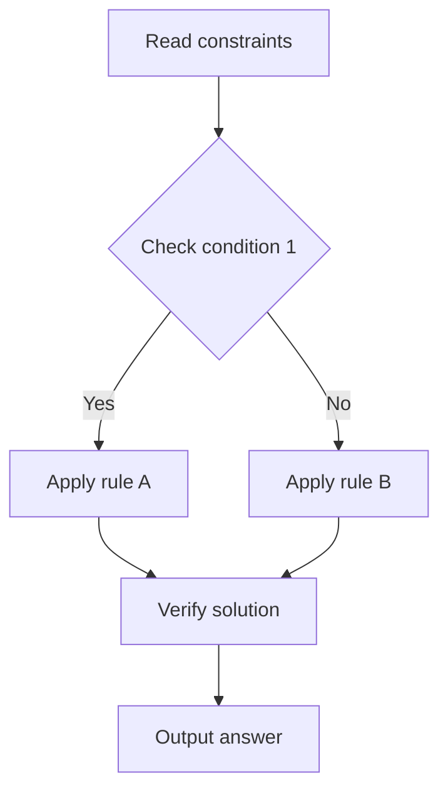

> ## Documentation Index
> Fetch the complete documentation index at: https://docs.openserv.ai/llms.txt
> Use this file to discover all available pages before exploring further.

# Research

> Summary of the BRAID paper, the research behind SERV Reasoning.

**BRAID** (Bounded Reasoning for Autonomous Inference and Decisions) is the research framework that SERV Reasoning is based on.

## Problem

Large language models exhibit non-linear cost-performance relationships. Classical chain-of-thought prompting increases token usage without proportional accuracy gains, which limits the deployability of autonomous agents in production.

## The insight

Models already understand structure better than prose. Instead of letting them "think out loud," BRAID replaces free-form reasoning with bounded, machine-readable reasoning graphs expressed as Mermaid diagrams. These diagrams encode logic as explicit flows — steps, branches, checks, and verification loops. The result is reasoning that is:

* **Deterministic** instead of verbose.
* **Compact** instead of token-heavy.
* Far less prone to **context drift**.

A simplified example of the Mermaid format BRAID uses:

Each token serves a specific role in constructing the diagram. Because the reasoning structure is clearer, smaller and cheaper models can reliably execute it.

The framework decouples reasoning planning from execution: a capable **generator** model produces the diagram, and a (potentially smaller) **solver** model uses it as system context to produce the final answer.

## Evaluation

The paper evaluates OpenAI GPT models (GPT-4 and GPT-5 variants across nano, mini, and medium configurations) on three benchmarks: **GSM-Hard** (100 questions), **SCALE MultiChallenge** (272 questions), and **AdvancedIF** (100 questions).

## Results

| Benchmark | Configuration | Result |
| - | - | - |
| GSM-Hard | GPT-4.1 generator + GPT-5-nano-minimal solver | 96% accuracy, 74.06× performance-per-dollar |
| GSM-Hard | GPT-5-nano-minimal (single model) | 94% → 98% accuracy with BRAID |
| SCALE MultiChallenge | GPT-4o | 19.9% → 53.7% accuracy with BRAID |
| SCALE MultiChallenge | GPT-5-medium generator + GPT-5-nano-medium solver | 59.2% accuracy, 30.31× performance-per-dollar |

The full paper is at [arXiv:2512.15959](https://arxiv.org/abs/2512.15959). Raw benchmark data is at [benchmark.openserv.ai](https://benchmark.openserv.ai/).

This documentation is built and hosted on [Mintlify](https://mintlify.com), a developer documentation platform.