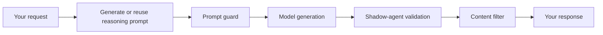

> ## Documentation Index
> Fetch the complete documentation index at: https://docs.openserv.ai/llms.txt
> Use this file to discover all available pages before exploring further.

# Guided tutorials

> Go from account creation to a monitored SERV Reasoning integration.

Complete the first four tutorials to send a working request. Then add the features your application needs:

1. [Create an account](https://docs.openserv.ai/serv-reasoning/tutorials/account.md)
2. [Add credits and create an API key](https://docs.openserv.ai/serv-reasoning/tutorials/credits-and-api-keys.md)
3. [Try the Playground](https://docs.openserv.ai/serv-reasoning/tutorials/playground.md)
4. [Make your first request](https://docs.openserv.ai/serv-reasoning/tutorials/first-request.md)
5. Add [prompt protection](https://docs.openserv.ai/serv-reasoning/tutorials/prompt-guard.md), [output validation](https://docs.openserv.ai/serv-reasoning/tutorials/shadow-agent.md), [structured outputs](https://docs.openserv.ai/serv-reasoning/tutorials/structured-outputs.md), [Kronos](https://docs.openserv.ai/serv-reasoning/tutorials/kronos.md), [Multipath](https://docs.openserv.ai/serv-reasoning/tutorials/multipath.md), and [application tools](https://docs.openserv.ai/serv-reasoning/tutorials/tools.md).
6. [Monitor usage and billing](https://docs.openserv.ai/serv-reasoning/tutorials/usage-and-billing.md), then [migrate your existing integration](https://docs.openserv.ai/serv-reasoning/tutorials/migrate-existing-integration.md).

[Prompt Guard](https://docs.openserv.ai/serv-reasoning/tutorials/prompt-guard.md), the [content filter](https://docs.openserv.ai/serv-reasoning/tutorials/content-filter.md), [Shadow Agent](https://docs.openserv.ai/serv-reasoning/tutorials/shadow-agent.md), [Kronos](https://docs.openserv.ai/serv-reasoning/tutorials/kronos.md), [Multipath](https://docs.openserv.ai/serv-reasoning/tutorials/multipath.md), and [prompt caching](https://docs.openserv.ai/serv-reasoning/tutorials/prompt-caching.md) solve different problems. Choose them according to the risks you need to block, the output quality you need, and the latency you can accept.

## How the features fit together

SERV features run at different points in one request:

Prompt caching can reuse SERV’s generated reasoning prompt. Prompt Guard checks the request before the requested model runs. Shadow Agent validates a completed answer and can request a revision. For Chat Completions and Responses, the content filter then screens output for leakage of SERV’s generated reasoning prompt.

You can combine these features. Prompt Guard, Shadow Agent, and Kronos add model calls when they run. A cache hit avoids a new reasoning-prompt generation call. Add each feature only after measuring its effect on your own requests.

This documentation is built and hosted on [Mintlify](https://mintlify.com), a developer documentation platform.