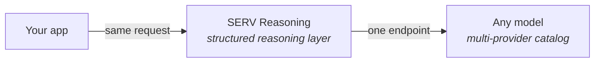

> ## Documentation Index
> Fetch the complete documentation index at: https://docs.openserv.ai/llms.txt
> Use this file to discover all available pages before exploring further.

# Why SERV Reasoning

> Better results from the models you already use.

SERV Reasoning is an inference API for LLMs. Each call runs through a structured reasoning step, following a bounded graph, that improves the consistency and accuracy of outputs.

It sits between your application and the model: the same request returns **more reliable results, at lower cost**, with no change to how you build.

> [card] Better outputs
>
> Every request runs through a reasoning step — more accurate and consistent outputs than calling the model directly.

> [card] Lower cost
>
> Pair a smaller model with SERV Reasoning to reach a larger model's quality. Savings scale with volume.

> [card] No code changes
>
> Change the base URL and API key in your existing OpenAI or Anthropic SDK. Nothing else changes.

> [card] One endpoint, many models
>
> A broad catalog of models behind a single endpoint and a single API key.

> [card] [Try before you integrate](https://console.openserv.ai/playground)
>
> Compare any model with and without SERV Reasoning in the Playground. No code required.

> [card] Same build. Better results.
>
> One layer between your app and the model. More reliable, cheaper, zero rewrite.

These are available as [SERV Tools](https://docs.openserv.ai/serv-reasoning/tools.md): turn them on or off by adding a tool to any request, in any SDK.

> [card] [Prompt injection guard](https://docs.openserv.ai/serv-reasoning/tools.md#serv_prompt_guard)
>
> Protect your system prompt from injection-based leakage. Opt in with the `serv_prompt_guard` tool.

> [card] [System-prompt content filter](https://docs.openserv.ai/serv-reasoning/tools.md#serv_disable_content_filter)
>
> On by default: SERV blocks output that would reveal your system prompt. Disable it per request with the `serv_disable_content_filter` tool.

> [card] [Shadow agents](https://docs.openserv.ai/serv-reasoning/tools.md#serv_shadow_agent)
>
> Difficult tasks reach higher accuracy through a validate-and-iterate loop. Opt in with the `serv_shadow_agent` tool.

Full technical diagram of SERV Reasoning engine:

This documentation is built and hosted on [Mintlify](https://mintlify.com), a developer documentation platform.